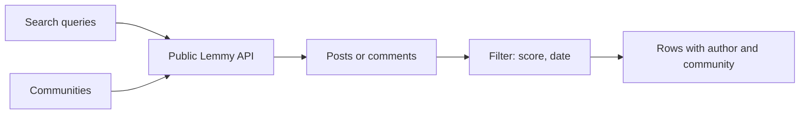

# Lemmy Scraper: Posts and Comments from Any Lemmy Instance

[](https://apify.com/Turboextract/lemmy-posts-comments)
[](LICENSE)
[](#pricing)

**Export posts and comments from Lemmy, the open Reddit alternative, by keyword, community or instance.** Each row has the title, link, text, score, upvotes, comment count, author, community and date. Uses the public Lemmy API, so it works on lemmy.world, programming.dev and any other instance with no login.

In one test, a search for "linux" on lemmy.world returned 60 posts from communities across the fediverse in a few seconds.

**Try it now →** [apify.com/Turboextract/lemmy-posts-comments](https://apify.com/Turboextract/lemmy-posts-comments)

---

## Why this exists

- Lemmy is spread across many servers, and its search has no export.
- Communities that left Reddit are hard to track with social listening tools.
- Mentions often sit in comments, which are slow to read by hand.
- Most social tools charge monthly and skip the fediverse.

---

## Who this is for

- **Brands and founders** tracking mentions in open-source and privacy communities
- **Developer relations teams** finding discussions about their tools
- **Researchers** studying communities that moved from Reddit
- **Marketers** finding questions to answer and topics people care about
- **AI and data teams** collecting public discussion text

---

## What you get

```json
{
  "type": "post",
  "id": 54646626,
  "title": "what good development IDE for making websites??",
  "postUrl": "https://lemmy.world/post/54646626",
  "text": "it needs to meet those criteria: ...",
  "publishedAt": "2026-11-20T17:34:42.528647Z",
  "author": "username",
  "community": "programming",
  "communityUrl": "https://programming.dev/c/programming",
  "score": 7,
  "upvotes": 8,
  "downvotes": 1,
  "comments": 7
}
```

Comment rows have `text`, `replies`, `postId`, `postTitle` and `postUrl`.

---

## How it works



---

## Quick start

1. Click **Try for free**.
2. Add **Search queries**, **Communities**, or both.
3. Pick **Posts** or **Comments** and a **Sort**.
4. Optional: change the **Instance**, or set **Minimum score** or **Posted within (days)**.
5. Click **Start**, then export to CSV, JSON or Google Sheets.

### API

```bash
curl -X POST "https://api.apify.com/v2/acts/Turboextract~lemmy-posts-comments/run-sync-get-dataset-items?token=YOUR_TOKEN" \
  -H "Content-Type: application/json" \
  -d '{"searchQueries": ["your product"], "contentType": "comments", "postedWithinDays": 7}'
```

### Python

```python
from apify_client import ApifyClient

client = ApifyClient("YOUR_TOKEN")
run = client.actor("Turboextract/lemmy-posts-comments").call(run_input={
    "communities": ["technology", "selfhosted"],
    "sort": "Top",
    "maxResultsPerQuery": 50,
})
for p in client.dataset(run["defaultDatasetId"]).iterate_items():
    print(p["score"], p["community"], p["title"])
```

---

## Input fields

| Field | Default | What it does |
|---|---|---|
| `searchQueries` | – | Keywords |
| `communities` | – | Names or URLs, like `technology@lemmy.world` |
| `contentType` | posts | Posts or comments |
| `sort` | New | Newest, top, hot, active or most comments |
| `instance` | lemmy.world | Any Lemmy server |
| `minScore` | 0 | Skip low-scoring items |
| `postedWithinDays` | 0 (all) | Only recent items |
| `maxResultsPerQuery` | 100 | Per query or community |
| `maxResults` | 500 | Total cap per run |

---

## Pricing

**$0.003 per post or comment delivered.** 1,000 items cost $3.

| Option | 1,000 items |
|---|---|
| **Lemmy Scraper** | **$3**, posts and comments, any instance |
| Other Lemmy actors on Apify | $0.30 to $10 |
| Social listening tools | $50+ a month |

---

## Common use cases

- **Mention alerts**: your product name in comments, every day
- **Community research**: top posts in technology, privacy or self-hosting
- **Content ideas**: questions people ask in your niche
- **Sentiment tracking**: scores and comment counts for a topic over time
- **Reddit alternative data**: the same kind of discussion, from an open API
- **Self-hosting research**: top posts in selfhosted and homelab communities

---

## Tips for best results

- lemmy.world sees posts from most other instances, so it is a good default.
- Use a community name with `@server` for communities hosted elsewhere.
- Dedupe on `id` across scheduled runs.
- Lemmy search matches whole words, so try a few spellings.

---

## Pairs well with

- [Hacker News Scraper](https://apify.com/Turboextract/hacker-news-search): developer discussion on HN
- [Mastodon Scraper](https://apify.com/Turboextract/mastodon-posts-hashtags): fediverse posts by hashtag
- [Bluesky Scraper](https://apify.com/Turboextract/bluesky-posts-profiles): posts and profiles from Bluesky

---

## FAQ

**Do I need a Lemmy account?** No. The actor uses the public API.

**Which instances work?** Any Lemmy server. Set it in **Instance**.

**Does it get NSFW posts?** Only if the instance shows them publicly. Each row has an `nsfw` flag.

**How fast is it?** About 50 items a second, with polite pauses between pages.

**Is it legal?** It reads public posts through Lemmy's open API.

---

## SEO keywords

Lemmy scraper, Lemmy API, scrape Lemmy posts, Lemmy comments export, lemmy.world scraper, fediverse scraper, Reddit alternative scraper, Lemmy community data, social listening fediverse, Lemmy search

---

## Support

- Actor page: https://apify.com/Turboextract/lemmy-posts-comments
- Issues and questions: open an issue in this repo
- Community Discord: https://discord.gg/8SrXSCpvgj

Built and maintained by [Turboextract](https://apify.com/Turboextract) on the Apify platform.

---

## License

The documentation and examples in this repository are MIT licensed. The actor itself runs on the Apify platform.
